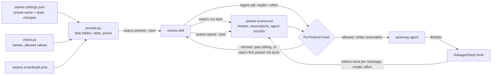
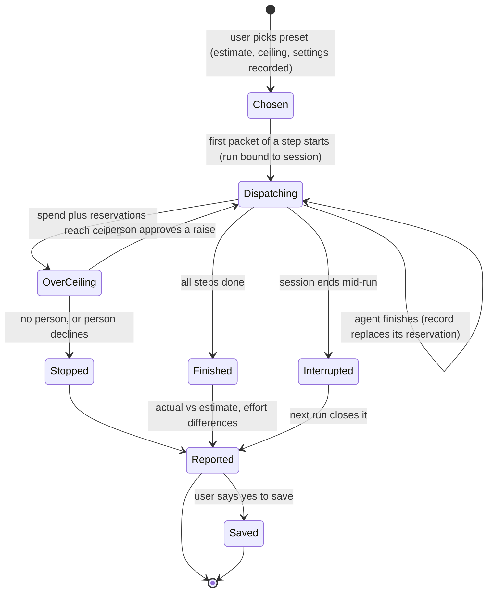

# Default Presets and Tuning - Plan

## Goal Capsule

- **Objective:** A team adopting seamreg chooses an informed level of spend before its first paid run, gets the measured best value at that level, and keeps using seamreg afterwards without cost surprises.
- **Means:** named presets that the tool defines and the review skill applies to every agent it starts, with a hook that records real spend and effort (KTD3, KTD5, KTD6).
- **Product authority:** this plan covers the presets, how they are chosen, applied, capped, saved and tuned, and the docs that explain them. The opt-in usage ping, dogfooding seamreg on this repo, and budget-style presets are not active scope.
- **Authority order:** the Product Contract's Requirements win on behavior. Key Technical Decisions win on mechanism. Units override neither.
- **Execution profile:** one pull request, branched from `origin/main` (KTD1). Units land as separate commits in U-ID order.
- **Stop conditions:** stop and report if U1 shows the measured runs used settings that contradict a preset Key Decision, or if U4's probe shows plugin hooks cannot see subagent transcripts.
- **Who ships:** the implementer builds and verifies locally. Sean approves the push, the PR and each paid run, including the cheap verification runs.
- **Open blockers:** none for implementation. Two paid runs wait on Sean (Open Questions).

---

## Product Contract

Product Contract preservation: restructured and changed with confirmation at the plan synthesis on 2026-11-20.
- Restructured, no scope change: R2 and R3 gain a drift check step, and the rule that every step names a model and effort moved to new R18.
- Changed: R8 adds that a run with no person to answer stops and reports. R13 now asks once after a definition change instead of only saying so. New R19 records each agent's actual model and effort and reports a difference before the next batch. R18 sets all in's drift check and re-rate at max.
- Corrected in review: standard's cost is about 20% of all in, not 30 to 40%. The choice-at-start Key Decision now matches R11 and R12.

### Summary

The review skill opens with a choice of two presets, standard and all in, shows each one's estimated cost for this repo, and applies the chosen preset by passing the model and effort explicitly to every agent it starts. At the end it offers to save the choice for later runs. A docs page explains every preset and setting with the evidence behind it.

### Problem Frame

A team that hears about seamreg cannot tell in advance what a run will cost or what it buys. Today there is one path: a full review whose settings live in agent files and in the skill's prose. No command flag or repo setting chooses a model or effort, and the only per-repo setting is `"notes"`.

When a setting is wrong, nobody sees it until the bill. On 2026-11-20 a lead check inherited a max-effort session and cost $129.54 against about $13 at the measured high effort. The session asked for approval, and the automatic yes gave it. Some steps are also worth far more per dollar than others. Sonnet reviewers found as many known drifts as Opus at 57 to 60% of the cost. A high-effort lead check adds about 2 known drifts for under $10. A cheap lead check alone, as shipped, barely beats no registry.

The person this is for hesitates at the price of a first run, as an early user did. Success means people move to a fuller level, or stay at a cheaper one. Failure means they stop using seamreg.

### Key Decisions

- **Presets backed by benchmarks, with individual settings underneath.** A newcomer picks a named level. A team that wants control tunes single settings. Governs R1, R14, R15.
- **Two presets, standard and all in. No cheap "try it" preset for now.** Governs R2, R3, R5. (session-settled: user-directed, chosen over rebuilding the lead check the hand-built way and retesting, and over offering "try it" as experimental: the shipped lead check scored 16 of 36 against 13 with no registry and 22 for the hand-built version.)
- **Standard is the entry preset. On the one measured repo it costs about 20% of all in (about $31 against $157), inside the 10 to 25% target.** Governs R2, R5. (session-settled: user-approved, chosen over measuring a cheaper standard first: standard is the cheapest preset with measured benefit.)
- **All in runs every step at max effort on Sonnet, with an Opus risk re-rating.** Governs R3. (session-settled: user-approved, chosen over Opus everywhere: Opus reviews found no more known drifts at about 1.7 times the cost.)
- **The choice is asked at the start of a run when no preset is saved or a full re-scan runs, and saving it is offered at the end of each run.** Governs R6, R10, R12. (session-settled: user-directed, chosen over a setting that must be saved before use, and over asking with no option to save.)
- **Diff scans run on the saved preset unless the estimate is large. A full re-scan always asks.** Governs R11, R12. (session-settled: user-directed for the diff-versus-full rule. User-approved for the size limit, chosen over letting diffs always run as saved.)
- **A saved preset follows its name across releases and keeps the team's own changes.** Governs R10, R13. (session-settled: user-approved, chosen over pinning every setting's value: teams get better measured defaults without re-choosing.)
- **Settings change both in plain words for one run and by editing the saved settings.** Governs R14, R15. (session-settled: user-directed, chosen "both" over either alone.)
- **The docs explain everything, the skill shows a short choice and a link, and the tool holds the one definition of each preset.** Governs R4, R6, R16. (session-settled: user-approved, chosen over carrying the full explanation in the skill: a second copy would drift, and long skills cost context on every run.)
- **The skill applies the preset. The tool describes it (approach A).** Governs R7, R8, R9. (session-settled: user-approved, chosen over the tool running the paid steps itself, and over budget-style presets.)
- **The lead check in both presets uses its default mode,** which records only seams whose copies disagree or share a mistake. The shipped keep-agreeing mode underperformed alone, and its effect after a review is unmeasured. Governs R2, R3.
- **The opt-in usage ping gets its own brainstorm.** This plan only makes each run know its preset. Governs R17. (session-settled: user-approved, chosen over designing the ping here. The ping itself is user-directed, chosen over feedback-only learning.)
- **A run never passes its estimate silently, and a run with nobody to answer never raises its own ceiling.** Governs R8. (session-settled: user-approved at the plan synthesis, chosen over a soft stop the agent can wave through: an automatic yes caused the $129.54 lead check.)
- **A changed preset definition asks once on the next run, even a diff scan.** Governs R13. (session-settled: user-approved at the plan synthesis, chosen over only saying it changed: nobody pays a new price they did not agree to.)

<!-- ce-section: work-relationships -->
### How This Work Fits Together

This plan covers default presets and tuning. The surrounding areas are the current understanding, not a committed roadmap.

- Opt-in usage ping: Depends on this plan's per-run record (R17). Still to decide: what it sends, where, and how consent is asked.
- A cheap entry preset ("try it"): Depends on a lead-check configuration that passes the prevention replay test (R5). Can proceed independently of the ping.
- Budget-style presets (approach C): Shares this plan's preset definitions and estimator. Still to decide once more steps are measured.
- Dogfooding seamreg on this repo: Can proceed independently of this plan, and would use its presets once they ship.
- The `harness-followup` branch (local, unpushed): Shares `bench/session.sh` with U8. Still to decide which lands first. The second rebases.

### Actors

- A1. A newcomer who hesitates at the cost of a first run.
- A2. A team that trusts the benefit and wants the fullest run.
- A3. The agent running the review skill.
- A4. The seams tool, which holds the preset definitions and estimates.
- A5. The plugin's hooks, which record spend and effort and refuse an out-of-preset dispatch.

### Key Flows

- F1. First run.
  - **Trigger:** A1 or A2 asks the agent to find the repo's seams, and no preset is saved.
  - **Steps:** A4 estimates each preset's cost for this repo. A3 shows the choice with a link to the docs. The user picks. A3 starts the run record, then runs each paid step's first packet alone and the rest in batches, with explicit model and effort (R7). A5 records each finished agent (R19) and refuses dispatches past the estimate (R8). A3 reports actual against estimated cost (R9) and offers to save (R10).
  - **Covers** R6 to R10, R17 to R19.
- F2. Later diff scan.
  - **Trigger:** A saved preset exists and the agent runs a re-scan of new leads.
  - **Steps:** A4 estimates the diff and a full run on the same preset. If the diff is under the size limit and the preset's definition is unchanged, A3 runs it without asking. Otherwise A3 asks (R11, R13).
  - **Covers** R11, R13.

### Requirements

**Presets**

- R1. The tool defines two named presets, standard and all in, each listing its steps with a model and an effort for each step.
- R2. Standard runs a Sonnet review at max effort, a drift check, the lead check at high effort, and an Opus risk re-rating.
- R3. All in runs the same steps with every step at max effort.
- R18. Each preset sets a model and an effort for every step it runs. Standard's drift check and re-rating use the values the measured runs actually used. All in runs them at max, per R3.
- R4. Each preset's documented benefit and cost cite the benchmark measurements behind them.
- R5. A cheaper preset is added only after a configuration of it passes the prevention replay test against the no-registry and reviewed baselines.

**Choosing and applying**

- R6. When no preset is saved, the review skill opens by showing each preset with this repo's estimated cost, a one-line statement of what it buys, and a link to the docs page, and waits for a choice.
- R7. Every agent the review skill starts receives the preset's model and effort for its step explicitly, including lead checkers, drift checkers and the risk re-rater.
- R19. Each finished agent's actual model and effort are recorded. A difference from the preset is reported before the next batch starts, and again in the end-of-run report.
- R8. When a run's spend passes its estimate, the skill stops and asks before it continues. A run with no person to answer stops and reports instead.
- R9. At the end of a run, the skill reports the actual cost next to the estimate.

**Saving and later runs**

- R10. At the end of a run, the skill offers to save the preset and any settings changed for this run. Nothing is saved without a yes.
- R11. A diff scan runs on the saved preset without asking, unless its estimate passes a quarter of a full run on the same preset, in which case the skill shows the cost and asks.
- R12. A full re-scan always asks which preset to use.
- R13. A saved preset is stored by name with only the settings the team changed. A later release's definition of that name applies, and the next run after a definition change asks once, even on a diff scan.

**Tuning**

- R14. A user can change any single setting for one run by saying so in plain words.
- R15. A team can edit its saved settings by hand, and `seams check` fails on an unknown setting or an invalid value.
- R16. A docs page lists every preset and setting, with pros and cons, the evidence, the default, and how to change it. The skill links to it and does not copy it.

**Readiness for follow-ons**

- R17. Each run records locally which preset and settings it used, so a later usage ping can report them.

### Acceptance Examples

- AE1. **Covers R6.** A repo with no saved preset: the skill shows standard and all in with their estimates for this repo and a docs link, and starts nothing until the user picks.
- AE2. **Covers R11.** A repo saved on standard. A diff scan estimated at 10% of a full standard run starts without a question.
- AE3. **Covers R11.** A repo saved on all in. A diff scan estimated at 40% of a full all-in run shows its cost and asks.
- AE4. **Covers R13.** A repo saved on standard with the lead check changed to xhigh. After a release that changes standard, the next run asks once, then uses the new standard with the lead check at xhigh.
- AE5. **Covers R14, R10.** A repo saved on standard. The user says "use Opus reviewers this time". This run uses Opus reviewers, and the end-of-run offer includes saving that change.
- AE6. **Covers R15.** A saved setting with a misspelled name makes `seams check` fail with the name.
- AE7. **Covers R8.** A run whose spend passes its estimate stops and asks. It does not continue on an automatic yes.
- AE8. **Covers R8.** A headless run on the benchmark harness passes its estimate. It starts no more agents and ends with a report of what finished and what did not.
- AE9. **Covers R7, R19.** `CLAUDE_CODE_EFFORT_LEVEL=max` is set while standard runs. The first lead-check packet's record shows max, and the run reports the difference before it starts the next batch. If the higher cost puts the step's new estimate past the ceiling, the skill shows it and asks. The ceiling itself does not move.
- AE10. **Covers R17.** A run is interrupted after three packets. The next run reports the open run and its recorded spend, and closes it before it starts a new one.

### Success Criteria

- People move from standard to all in, or stay on standard: both count as success. People who stop using seamreg after a first run count as failure. Measuring this depends on the usage ping follow-on.
- Each shipped preset reproduces its documented benchmark numbers within run-to-run noise when run through the benchmark harness.
- A preset run's actual agent cost lands within 30% of its estimate, on the calibration repo and on at least one repo outside the calibration data. A wider gap means the estimator needs another calibration point before release.

### Scope Boundaries

Deferred for later:
- A cheap "try it" preset, until a configuration passes R5's test.
- The opt-in usage ping.
- Budget-style presets that fill a budget by measured value per dollar.
- The tool running paid steps itself as headless sessions.
- The keep-agreeing lead-check mode, code excerpts in packets, and quoted evidence as preset defaults.
- Dogfooding seamreg on this repo.

Not changed by this plan:
- Everyday agent behavior: the edit hook, the Stop hook, the planning text and the pre-PR scan cost nothing extra or run inside the agent's own session.
- The tie writer, gap pass and focused passes keep their current skill text. They are outside R2 and R3.

Considered and not built:
- Resuming an interrupted run. Closing it with a report (AE10) keeps the record honest. Resume would need per-packet state the skill does not keep. Evidence that would change this: users interrupting long first reviews.
- A spend margin setting. The stop happens at the estimate (R8), and batch sizing bounds the overshoot (KTD6). A margin adds a knob with no measured use.
- Stopping agents that are already running. Assumption (unverified): no hook can cancel a running subagent. The hooks page documents none. Reservations (KTD6) bound the cost instead.
- A hook that refuses a dispatch at the wrong effort. The agent-file floors (KTD8), the per-call effort (R7), and the record reported before the next batch (R19) already catch a wrong effort within one packet. `CLAUDE_CODE_EFFORT_LEVEL` would also make a per-call comparison unreliable.
- A warning window for renamed settings. The settings file is new in this release, so no saved key can be renamed yet. Add the window in the first release that renames one.

### Dependencies / Assumptions

- Verified: the review skill tells the agent to set reviewers' effort with the agent tool's effort setting (`skills/seams-review/SKILL.md:16-17`). Lead checkers and drift checkers get no such instruction (`SKILL.md:37`, `:63-70`).
- Verified: an agent file's `effort` field sets that agent's effort, a per-call `effort` parameter overrides it (Claude Code v2.1.292 or later), and `CLAUDE_CODE_EFFORT_LEVEL` overrides both. With none set, an agent on the session's model takes the session's effort (code.claude.com/docs/en/sub-agents.md, quoted 2026-11-20).
- Verified: a subagent transcript records the model, token usage and effort of every message (a subagent transcript under `~/.claude/projects/`, read 2026-11-20). The SubagentStop hook input carries `agent_transcript_path` and `agent_type` and no cost (code.claude.com/docs/en/hooks.md).
- Verified: a transcript splits one response across several lines that repeat the same `message.usage` under one `message.id`. Summing per line roughly doubles the count: 49,002 against 26,904 output tokens on one subagent transcript, read 2026-11-20.
- Verified: the plugin is the whole repo (marketplace source `"./"`), and the harness loads it with `--plugin-dir`, so `${CLAUDE_PLUGIN_ROOT}/src` holds the tool's own code in both setups. The harness prompt runs the tool through `uvx`, and `seams` is not on its PATH (per the feasibility review, `bench/kinds/detection/prompt.md`).
- Assumption (unverified): hook input carries the session id, so a run can be bound to one session. Subagent transcript lines carry `sessionId`. U4 probes the hook input.
- Assumption (unverified): plugin hooks fire under the harness's `--setting-sources ""`. U4 probes it under the harness's flags.
- Verified: an older checker copy rejects an unknown top-level field in `seams.json` (`src/seams/check.py:149`, `:241-242`). The hooks then go quiet (`check.py:687-688`, `:708-709`), and `seams next` treats the repo as unreviewed (`src/seams/passes.py:87-94`).
- Verified: today's cost estimate is a fixed cost per packet times the packet count (`src/seams/split.py:50`, `:539-541`), and lead-only passes print "not measured" (`split.py:535-537`). On this repo a full plan and a diff plan are both one packet.
- Assumption (unverified): a plugin can declare hooks in its own `hooks/hooks.json`, and they fire only in sessions where the plugin is installed. U4 probes this first.
- Assumption (unverified): a PreToolUse hook on the Agent tool sees the call's `effort` value. The hooks page's Agent input table lists only `prompt`, `description`, `subagent_type` and `model`. U5 probes this first.
- Assumption (unverified): agents other than Claude Code may not accept a per-call effort or run plugin hooks. There the presets fall back to the model choice plus the effort stated in words, and spend is not recorded.
- Assumption (unverified): the cost ratios measured on one 555-file repo hold on other sizes. R6 shows the per-repo estimate for this reason.
- Assumption (unverified): one run per configuration does not change which preset wins. Each comparison so far is one run, and runs vary by about one known drift.
- Assumption (unverified): a lead-only review costs about the same per line as a first review. One measured re-scan checks it (Verification Contract).

### Sources / Research

- `docs/benchmarks.md` (models compared, prevention results), `docs/passes.md` (costs per pass), `docs/usage.md` (re-scans).
- `skills/seams-review/SKILL.md`, `agents/*.md`, `src/seams/split.py`, `src/seams/leadcheck.py`, `src/seams/passes.py`, `src/seams/check.py`, `src/seams/merge.py`.
- Claude Code docs: code.claude.com/docs/en/sub-agents.md (effort field and parameter), code.claude.com/docs/en/hooks.md (SubagentStop input, Agent tool response), code.claude.com/docs/en/cli-reference.md (`--effort`, `--max-budget-usd`).
- Machine-local, best effort: `~/seams-bench/defaults-evidence.md` (every measurement behind the presets), `~/seams-bench/harness-runs/vaultwarden-lead-check.md` (the lead check at four efforts), `~/seams-bench/leadcheck/test-tryit-main.log` (the shipped lead check's prevention test). A missing file is not a blocker. This plan's requirements govern.

---

## Planning Contract

### Key Technical Decisions

- KTD1. **Build on `origin/main`, not on `leadcheck-open-files`.** That branch turns on code excerpts and a quote rule by default (`src/seams/leadcheck.py:131`, `:142-151`), and that configuration scored 12 of 36 on prevention. The presets were measured on main's lead check. The branch stays local and unshipped. Governs R2, R3.
- KTD2. **Saved settings live in their own committed file, `seams.settings.json`, beside `seams.json`.** An older checker copy in a team's CI never reads it, so saving cannot turn CI red or silence the hooks. `seams apply` never writes it, so a hand edit survives a later merge. The file holds a schema version, the preset name, and only the settings the team changed (R13). The new checker validates it whenever it exists (R15). Chosen over a block inside `seams.json`, which the brainstorm first proposed, because of the old-copy failure in Dependencies / Assumptions.
- KTD3. **The names and the definitions live in two places with one direction.** `src/seams/check.py` holds the vocabulary it must validate: preset names, step names, setting keys, and allowed models and efforts. It stays standard-library only and Python 3.9 safe. A new module, `src/seams/presets.py`, imports those names and holds each preset's step table, the cost rates and the price table. Nothing else states a preset's values.
- KTD4. **Every estimate and every actual is in API-equivalent dollars, and both count the same thing: the seamreg agents.**
  - The rates are dollars per reviewed line for review steps, dollars per lead for the lead check, and dollars per seam for the drift check and re-rate. Each rate is keyed by model and effort.
  - Seam counts before a review come from a measured seams-per-line rate.
  - Every rate comes from child-agent transcripts, counted by the same code as KTD5, never from a harness session total.
  - The orchestrating session's own share is measured separately in U1. The estimate shows it on its own line, and the ceiling does not count it.
  - Today's mixed tokens and dollars (`split.py:50`, `leadcheck.py:25`) become one unit.
- KTD5. **A plugin SubagentStop hook records real spend.**
  - It acts only for a seamreg agent type, during an open run bound to the same session (KTD9).
  - It reads `agent_transcript_path` and counts each message once, by `message.id`, with `requestId` as the fallback. It sums tokens by model and prices input, output, cache-write and cache-read tokens separately.
  - It writes one record file per finished agent, with model, effort, tokens and dollars.
  - An agent whose transcript is missing, or whose model id is not in the price table, is recorded as "cost unknown". It counts toward the ceiling at its step's per-packet estimate, and the end-of-run report names it.
- KTD6. **A plugin PreToolUse hook on the Agent tool holds the ceiling, whatever the skill does.**
  - Each seamreg dispatch it allows becomes a reservation at the step's current per-packet estimate.
  - It refuses a dispatch when recorded spend plus open reservations plus this packet's estimate passes the ceiling.
  - It refuses a second agent of a step until that step's first agent has a record, so the first packet runs alone even if the skill text is ignored.
  - A finished agent's record replaces one open reservation of its type.
  - Outside an open run bound to this session, or for any other agent type, it allows everything.
  - Only `seams run raise` changes the ceiling. The skill runs it only after a person answers.
- KTD7. **The first packet's actual cost rescales that step's estimate, for batch sizing and reservations only.** When a rescaled estimate puts the run past its ceiling, the skill shows the new estimate and asks before the next batch. With no person to answer, it stops and reports. Governs R8, AE9.
- KTD8. **Agent files get an `effort` floor matching standard,** so a forgotten per-call effort falls back to the measured value instead of the session's. A test holds each agent's floor equal to standard's value for its step, and this repo's `seams.json` records the pair as a seam. All in still overrides the floor per call.
- KTD9. **The run record is local, under `.seams-scan/runs/`.**
  - `runs.json` holds the run header: id, preset, effective settings with the source of each, estimate, ceiling, status and the session id. Only `seams run` writes it.
  - The first allowed dispatch after `seams run start` binds the run to its session id. Both hooks act only when the hook input's session id matches.
  - Each finished agent and each reservation is its own file under `.seams-scan/runs/<run-id>/`, written to a temporary name and then renamed. Agents finishing together cannot overwrite each other's records, and a half-written header cannot be read.
  - Damage handling follows the pass ledger (`src/seams/passes.py:46-61`). Deleting `.seams-scan/` loses the record, as it does the ledger today.
- KTD10. **The tool prints machine-readable output for the skill.** `seams presets --json` gives each preset's steps, the effective settings with their sources, this repo's estimate per preset, the diff-to-full ratio, and whether the definition changed since the last run. `seams run` and `seams spend` give the run state and the ceiling check as JSON. The agent does no arithmetic. Exact command and flag names are settled in U3 and U4 and must pass the documented-commands seam.
- KTD11. **A diff scan is a lead-only pass, and it runs every step of the saved preset scoped to the diff.**
  - A diff scan is `seams split --new-only` or `--cross-area-only`, with or without a `--since` scan. A full re-scan is `seams split` with no lead filter, or `--gap`, on a repo that already has a registry. These are the pass kinds already in code (`src/seams/cli.py:514-515`).
  - In a diff scan, the review covers the new-lead packets and the lead check the new leads. The drift check and re-rate cover the new seams only, through `seams verify --ids` and a new `seams rerate --ids`.
  - The diff estimate prices exactly those counts. Governs R11, R12.
- KTD12. Removed in review: no saved key exists to rename yet (Scope Boundaries).
- KTD13. **The skill confirms the hooks are recording before it trusts the ceiling.** After the first packet of the first paid step, the run record must hold that agent's entry. If it does not, the hooks are not firing: the host is not Claude Code, Claude Code is too old, or the plugin hooks did not load. The skill then says spend is not being recorded, falls back to the token counts in completion notices, and asks before it continues. Without this check, a missing hook leaves recorded spend at zero, and the ceiling never trips. The skill also compares `seams --version` with the plugin's version before the first dispatch. Governs R8, R19.
- KTD14. **The hooks run the plugin's own code, not the `seams` command on PATH.** Each hook command runs `python3 -m seams.spend` with `PYTHONPATH="${CLAUDE_PLUGIN_ROOT}/src"`, and exits 0 when `python3` is missing. The harness has no `seams` on PATH, and an installed `seams` could be a different version from the plugin under test.

### System-Wide Impact

- **Every session with the plugin installed** gets two new hooks. They exit at once for agents outside seamreg and when no run is bound to the session, so everyday work pays one short process start per Agent call and per subagent finish. Each hook has a timeout, as the existing hooks do (`src/seams/snippets/claude-code-settings.json`).
- **Teams' vendored checkers** are not affected by a saved preset (KTD2). A team that upgrades its copy to 0.3.0 gains settings validation in CI.
- **The `seams` command and the plugin now have to match** for the commands the skill runs. KTD13 catches a mismatch before the first dispatch. The hooks avoid it by running the plugin's own code (KTD14).
- **Benchmark comparability.** Runs before 0.3.0 used the session's effort for lead and drift checkers. Results from 0.3.0 runs record the preset, so `docs/benchmarks.md` must label which configuration each row used.
- **Agents other than Claude Code** get the presets as words only (Dependencies / Assumptions). The docs page says so.

### High-Level Technical Design

How the parts connect. The tool owns the definitions. The skill reads them and dispatches. The hooks hold the ceiling and record what actually ran.

The run lifecycle. Each state names what the run record holds.

### Open Questions

Deferred to implementation:
- The exact rates per step, model and effort, and the orchestrating session's share. U1 derives them from existing benchmark records.
- Which effort the measured drift checks and re-rates ran at. U1 reads it from the benchmark transcripts.
- Whether hook input carries the session id, and whether plugin hooks fire under the harness's flags. U4 probes both.
- Exact command names, flags and JSON field names.

Gates on Sean, not blockers to building:
- The cheap verification runs: standard on this repo, and one lead-only re-scan on a benchmark repo other than vaultwarden. A few dollars API-equivalent each.
- The standard reproduction run on vaultwarden, about $30 API-equivalent.
- The all-in reproduction run on vaultwarden, about $155 API-equivalent.
- The order of this PR and the `harness-followup` branch, which both touch `bench/session.sh`.

---

## Implementation Units

### U1. Calibrate the presets from existing records

**Goal:** Fix each preset step's model, effort and cost rate from what the measured runs actually did, without a new paid run.

**Requirements:** R4, R18, KTD4.

**Dependencies:** none.

**Files:**
- `src/seams/presets.py` (new: the rate table and the step tables, filled from this unit)
- `docs/presets.md` (new: the evidence table, one row per rate with its source, naming the calibration repo)
- `tests/test_presets.py` (new)

**Approach:**
1. From the benchmark transcripts, read the effort and model each step ran at: reviewers, drift checkers, lead checkers and the risk rater.
2. Count every child transcript once per message (KTD5). Derive dollars per reviewed line for Sonnet reviews at max, from the first-review records with known line counts.
3. Derive dollars per lead for the lead check at high and max, and dollars per seam for the drift check and re-rate.
4. Derive seams per reviewed line from the reviewed registries.
5. Measure the orchestrating session's share: the harness session total minus the summed child cost, per run.
6. Write the rates into `presets.py` with no benchmark repo names in tool text. Put the sources in `docs/presets.md`.

**Execution note:** measure from existing records first. If a step's recorded effort contradicts a preset Key Decision, stop and report (Goal Capsule).

**Patterns to follow:** the cost constants and their comments in `src/seams/split.py:44-50` and `src/seams/verify.py:49-63`.

**Test scenarios:**
- Each preset names a model and an effort for review, drift check, lead check and re-rate.
- Standard's lead check is Sonnet at high, and all in's is Sonnet at max.
- All in's drift check and re-rate are at max.
- Every model and effort in the step tables is in the checker's allowed values.
- No string in `presets.py` names a benchmark repo (the rule in `tests/test_leadcheck.py:57-60`).

**Verification:** every rate in `presets.py` has a row in `docs/presets.md` naming its source record.

### U2. Validate the settings file in the checker

**Goal:** `seams check` accepts a valid `seams.settings.json`, names any unknown or invalid setting, and older checker copies are unaffected.

**Requirements:** R13, R15, KTD2, KTD3.

**Dependencies:** none.

**Files:**
- `src/seams/check.py` (preset, step and key vocabulary, a settings schema, validation when the file exists, version 0.3.0)
- `schema/seams.settings.schema.json` (new, generated)
- `seams.settings.json` (new: this repo's own, holding only `"preset": "standard"`)
- `pyproject.toml`, `.claude-plugin/plugin.json` (version 0.3.0)
- `tests/test_settings.py` (new)

**Approach:**
1. Add a settings schema beside `SCHEMA`, with `additionalProperties: False` on each object so error paths name the key.
2. Keep within the validator's supported keywords and types (`check.py:167-177`). Express limits as integer percents with an enum or pattern, so no `number` type is needed.
3. Validate the file from `check()` when it exists. Report errors as `seams.settings.json: ...`.
4. Extend `seams schema --write` to write both schemas.

**Patterns to follow:** the `"notes"` setting (`check.py:67`, `:152-154`, `:802-817`) and its tests in `tests/test_notes.py:282-291`.

**Test scenarios:**
- Covers AE6. A misspelled step key fails with the file name and the key.
- An effort of `extreme` fails, naming the allowed values.
- A file with only `"preset": "standard"` passes.
- No settings file: `check()` reports no settings errors.
- The 0.2.0 checker run on a repo with a settings file still passes, because it never reads that file.
- The committed schema equals the generated one.
- The checker still imports nothing from the `seams` package, and runs alone on Python 3.9.

**Verification:** `python src/seams/check.py` passes on this repo with its new settings file, and the version tie test (`tests/test_own_seams.py:22-25`) passes at 0.3.0.

### U3. Resolve settings and estimate cost per preset

**Goal:** One command tells the skill each preset's effective settings and this repo's estimated cost, for a full run and a diff.

**Requirements:** R1, R6, R11, R13, R14, KTD4, KTD10, KTD11.

**Dependencies:** U1, U2.

**Files:**
- `src/seams/presets.py` (resolution and estimator)
- `src/seams/rerate.py` (an `--ids` filter, as `seams verify --ids` has)
- `src/seams/cli.py` (new `presets` subcommand, with text and `--json` output, and `rerate --ids`)
- `tests/test_presets.py`, `tests/test_rerate.py`

**Approach:**
1. Resolve effective settings in layers: the preset definition, then the saved changes, then one-run changes given as `--set step.key=value`. Record each value's source.
2. Estimate from `leads.json` after `seams scan`: reviewed lines from the filtered leads, the lead-check lead count from `leadcheck.select`, and the seam count from the seams-per-line rate. Show the orchestrating session's share on its own line (KTD4).
3. For a repo with a registry, also estimate the diff with each step scoped per KTD11, and give the diff-to-full ratio and whether it passes the limit.
4. Store a fingerprint of each preset's definition in the run header. Report "definition changed" when it differs from the last finished run.

**Patterns to follow:** `passes._first_review_tokens` (`src/seams/passes.py:117-127`) for an estimate built before any paid step, and `cmd_next` (`cli.py:402-405`) for a print-only command.

**Test scenarios:**
- Covers AE1. With no settings file, the output lists both presets with a dollar estimate each and no saved preset.
- A saved change of the lead check to xhigh shows source "saved" on that key and "preset" on the rest.
- `--set review.model=opus` shows source "this run" and raises the review estimate.
- An invalid `--set` key exits 2 with the checker's message.
- Covers AE2. A fixture with new leads at 10% of a full run reports the ratio under the limit.
- Covers AE3. A fixture at 40% reports the ratio over the limit.
- Covers AE4. A changed definition fingerprint reports "definition changed", and the team's xhigh change is kept.
- A repo with zero new leads reports a diff estimate of zero.
- `seams rerate --ids` writes packets for the named seams only.

**Verification:** the JSON output parses, and its estimate for this repo is in dollars.

### U4. Record runs and real spend

**Goal:** Each run has a local record, and every finished seamreg agent adds its real cost, model and effort to it.

**Requirements:** R9, R17, R19, KTD5, KTD9, KTD14.

**Dependencies:** U3.

**Files:**
- `src/seams/spend.py` (new: run header, per-agent records, transcript counting, price table use, and a `__main__` entry for the hooks)
- `src/seams/cli.py` (`run` subcommand to start, raise and finish, and `spend` for the state and ceiling check)
- `hooks/hooks.json` (new: the plugin's SubagentStop hook, per KTD14)
- `tests/test_spend.py` (new), `tests/fixtures/transcripts/` (new: excerpts from a real transcript, including one message split across several lines)

**Approach:**
1. Probe first, in an interactive session and under the harness's own flags (`bench/session.sh:106-108`):
   - Does a plugin `hooks/hooks.json` hook fire for a subagent?
   - Does it receive `agent_transcript_path`?
   - Does its input carry the session id?
   If the hook does not fire or gets no transcript path, stop and report (Goal Capsule). If the session id is missing, bind the run by the transcript's `sessionId`, and record the choice in the commit message.
2. `seams run start` writes the run header. It refuses while another run is open, and prints that run's state so the skill can close it (AE10).
3. The hook ignores agent types outside seamreg and sessions with no bound run. It never fails the session.

**Patterns to follow:** the pass ledger (`src/seams/passes.py:25`, `:46-61`) and its damage test (`tests/test_passes.py:60`).

**Test scenarios:**
- A fixture where one message spans three lines with repeated usage prices that message once.
- A transcript with Opus and Sonnet messages prices each model at its own rate.
- A transcript with a model id missing from the price table is recorded as "cost unknown" and counts at its step's per-packet estimate.
- Covers AE9. A lead-check transcript recorded at max during a standard run is marked as differing from high.
- A non-seamreg agent type adds nothing to the record.
- With no run bound to the session, the hook adds nothing and exits 0.
- A hook from another session adds nothing to a run bound to the first session.
- Two hook writes that overlap both leave their records.
- A damaged run header is set aside and a new one started, with a warning.
- Covers AE10. Starting a run while one is open refuses and prints the open run's spend.
- A missing or unreadable transcript records the agent as "cost unknown" without failing.

**Verification:** a hook run against a fixture payload writes its record file and exits 0.

### U5. Hold the ceiling at dispatch and set effort floors

**Goal:** During a run, no seamreg agent starts past the ceiling, a step's first packet runs alone, and a forgotten effort falls back to standard's value.

**Requirements:** R7, R8, KTD6, KTD8.

**Dependencies:** U4.

**Files:**
- `hooks/hooks.json` (PreToolUse hook on the Agent tool, per KTD14)
- `src/seams/spend.py` (the dispatch check and reservations)
- `agents/seam-reviewer.md`, `agents/seam-drift-checker.md`, `agents/seam-lead-checker.md`, `agents/seam-risk-rater.md` (`effort` floors)
- `seams.json` (a seam tying the floors to `presets.py`)
- `tests/test_spend.py`, `tests/test_agents.py` (new)

**Approach:**
1. The refusal message says why and what the skill does next: ask the person, then run the raise command, or stop and report.
2. Leave `seam-tie-writer.md` without a floor. Ties are outside the presets.

**Test scenarios:**
- Covers AE7. A lead-checker payload when recorded spend plus reservations reaches the ceiling is refused with a message naming the ceiling.
- The same payload after a raise is allowed.
- Ten lead-checker payloads in a row with no finished agent between them are refused once reservations fill the room. A finished record frees the room again.
- A second reviewer payload before the first reviewer has a record is refused.
- A payload for a non-seamreg agent is allowed, whatever the spend.
- With no run bound to the session, every payload is allowed.
- Each agent file's `effort` equals standard's value for its step.

**Verification:** the hook refuses and allows the fixture payloads as listed, and always exits within its timeout.

### U6. Rewrite the review skill around presets

**Goal:** The skill offers the choice, applies it, stays under the ceiling, reports, and offers to save.

**Requirements:** R6 to R14, R16, R17, R19, F1, F2, KTD7, KTD11, KTD13.

**Dependencies:** U3, U4, U5.

**Files:**
- `skills/seams-review/SKILL.md`
- `tests/test_workflow.py` (the step text it parses), `tests/test_skill_format.py`

**Approach:**
1. Step 3 becomes the preset step: run `seams presets --json`. If a preset is saved and no rule asks again, say which one runs. Otherwise show the short choice with the docs link. With no person to answer and a question due (R12, R13), stop and report before any paid step.
2. Before the first dispatch, check `CLAUDE_CODE_EFFORT_LEVEL` and `seams --version` (KTD13). If the variable is set, tell the user it overrides every preset effort. After the first packet, confirm the run record holds its entry (KTD13).
3. Start the run, then run each step's first packet alone and the rest in batches, passing model and effort on every Agent call.
4. Standard and all in run the lead check as a default step after the drift check, in place of today's offer after step 7 (`SKILL.md:65`).
5. When the hook refuses at the ceiling, or a rescaled estimate passes it (KTD7), ask the person. With no person to answer, stop, list the packets with no review, and report.
6. At the end, report actual against estimate, the orchestrating session's share as not counted, and any effort differences. Then offer to save the preset and this run's changes.
7. Map plain-words changes to one `--set` key each, repeat the change back with the new estimate, and validate it before the next paid step.
8. Keep step 5's span and step 6's number, which `tests/test_workflow.py:168-176` parses. Keep the file under the 500-line limit (`tests/test_skill_format.py:45`).

**Patterns to follow:** today's "Start one packet first and check its cost" (`SKILL.md:63-70`).

**Test scenarios:**
- The skill text names `seams presets`, `seams run` and `seams spend`, and every command it names exists (documented-commands seam).
- Step 5's parsed section names are unchanged.
- The skill links to `docs/presets.md` and states no preset's model or effort values itself.
- The skill file stays under 500 lines and passes the format test.
- The skill text tells the agent what to do when the first packet's record is missing: say spend is not recorded, use completion-notice tokens, and ask before continuing (KTD13).
- Covers AE5. In the cheap real run, the user says "use Opus reviewers this time". The run uses Opus reviewers, and the end-of-run offer includes saving that change.
- In the cheap real run with the hooks turned off, the skill reports that spend is not recorded and asks before the drift check, the second paid step on this repo.

**Verification:** a cheap real run of standard on this repo follows the flow end to end (Verification Contract).

### U7. Write the presets docs and correct cost claims

**Goal:** One docs page explains every preset and setting with its evidence, and no other page contradicts it.

**Requirements:** R4, R5, R16.

**Dependencies:** U1, U3.

**Files:**
- `docs/presets.md` (from U1: add the presets, every setting, pros and cons, defaults, how to change each, the orchestrating session's share, and the empty cheap slot with its reason)
- `README.md` (the "What it costs" section, `README.md:67-76`, including the claim that a cheaper lead check gets about half the benefit for a quarter of the price)
- `docs/passes.md`, `docs/usage.md` (settings file section beside `"notes"`, `docs/usage.md:102-123`), `docs/concepts.md` (settings file and run record terms), `CONTRIBUTING.md` (adding a preset needs R5's test)

**Approach:** write in STE flavored mode. Lint every changed page under 3 violations per 100 words, with no dashes and no semicolons. Name benchmark repos only in docs, never in tool text.

**Test expectation:** none for prose. The documented-commands seam test covers the command names the docs use.

**Verification:** the README's cost claims match `docs/presets.md`, and each changed page's lint score is under 3 per 100 words.

### U8. Let the benchmark harness run a preset

**Goal:** The harness can run a named preset headless, so the reproduction runs measure what ships.

**Requirements:** R8, AE8, Success Criteria.

**Dependencies:** U6.

**Files:**
- `bench/session.sh` (a `PRESET` setting, and per-preset answer text replacing the fixed yes at `bench/session.sh:46`)
- `bench/README.md` or the harness docs section in `docs/benchmarks.md`
- `tests/test_bench.py` (or the existing harness test file)

**Approach:**
1. The answer text names the preset and says to stop and report at the ceiling, never to raise it.
2. Record the preset name, the run record's agent spend and the harness session total in the result envelope.

**Test scenarios:**
- Covers AE8. With `PRESET=standard`, the generated answer text names standard and forbids raising the ceiling.
- An unknown `PRESET` value stops the harness before any paid call.

**Verification:** a dry run of the harness prints the answer text for each preset without starting a session, and one hook payload under the harness's flags writes its record.

---

## Verification Contract

- `pytest -q` passes on Python 3.9 and 3.13, as CI runs it (`.github/workflows/ci.yml`).
- `python src/seams/check.py` passes on this repo's own `seams.json` and `seams.settings.json`.
- `seams schema --write` leaves the committed schemas unchanged.
- Each changed docs page scores under 3 per 100 words on `ste-lint.py`, with zero dashes.
- Gated on Sean, cheap: standard on this repo (one packet per step), in Claude Code v2.1.292 or later. The run record shows each agent's model and effort matching standard. Actual agent spend lands within 30% of the estimate.
- Gated on Sean, cheap: one lead-only re-scan on a benchmark repo other than vaultwarden. It checks the per-line diff rate assumption, and its actual agent spend lands within 30% of the estimate.
- Gated on Sean: the standard and all-in reproduction runs on vaultwarden through the harness. Standard should land near 4 drifts plus 2 partial for about $30. All in should land near 8 plus 3 for about $155. Compare the run record's agent spend with the estimate, and give the harness session total beside it as the orchestrating session's share.

## Definition of Done

- Every unit's test scenarios pass, and the Verification Contract's ungated items pass.
- The plan's Acceptance Examples AE1 to AE10 each map to a passing test or to a cheap real run.
- No preset value appears outside `presets.py`, apart from the agent floors tied by the seam and test in U5.
- `docs/presets.md` cites a source for every rate, and the README makes no claim the evidence does not support.
- Experimental or abandoned code from the probes in U4 is removed from the diff.
- Nothing is pushed or opened as a PR, and no paid run starts, until Sean approves.
